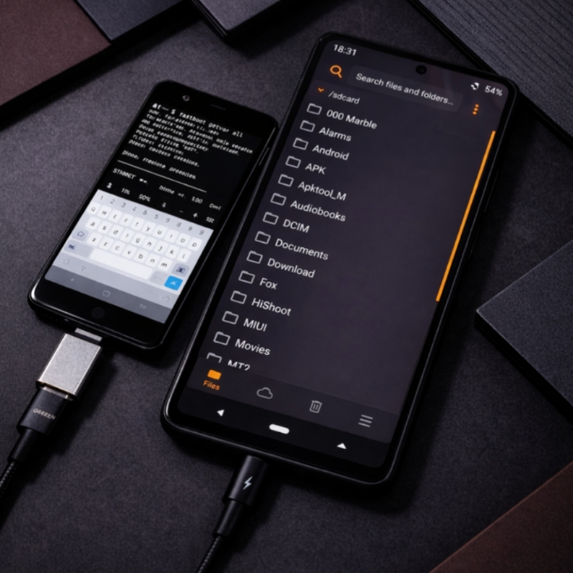
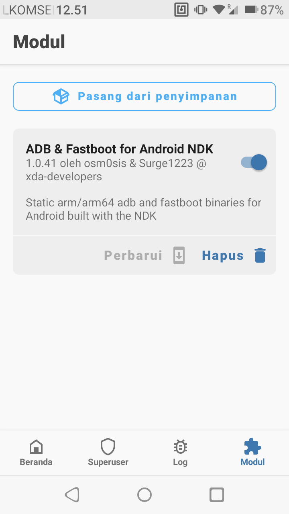
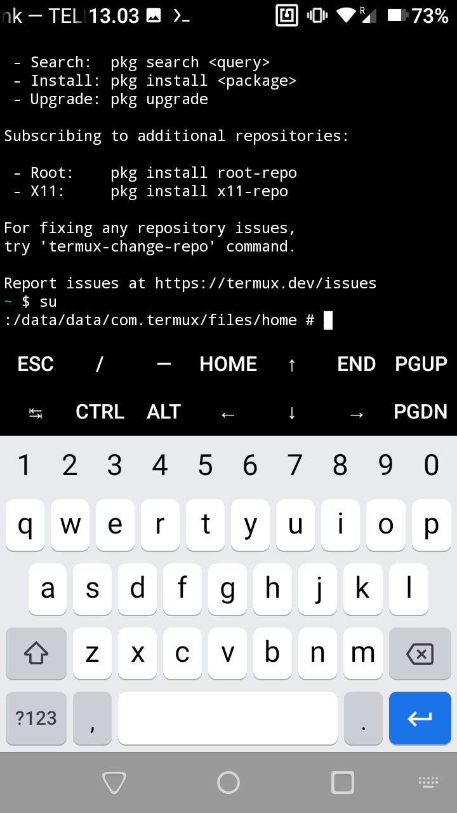
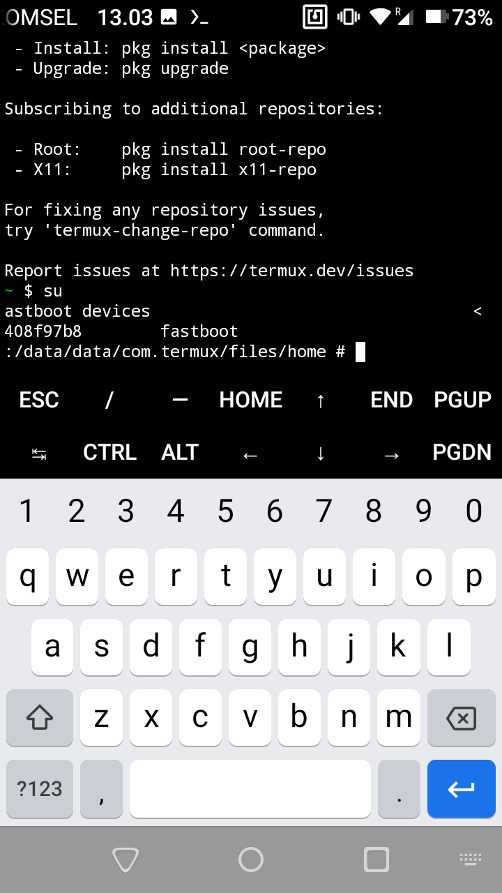
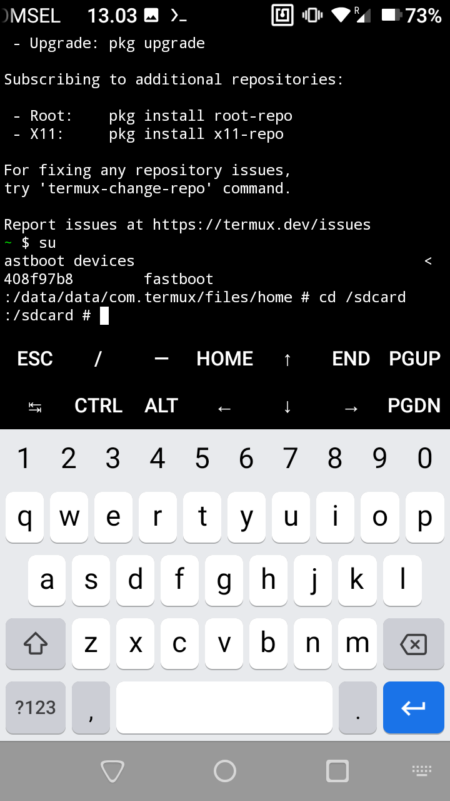
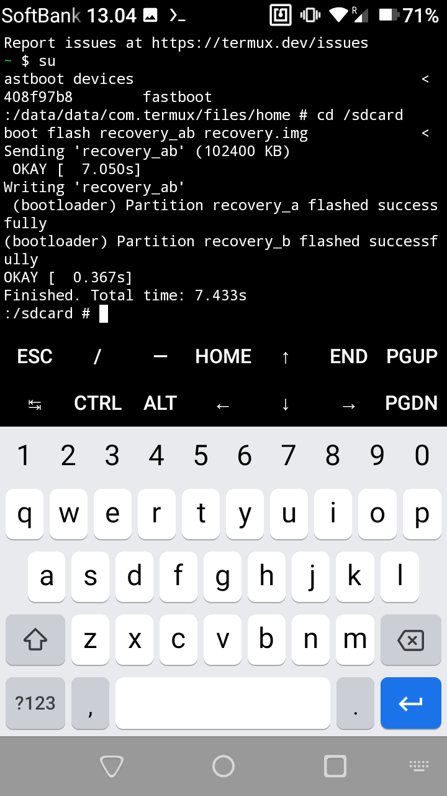
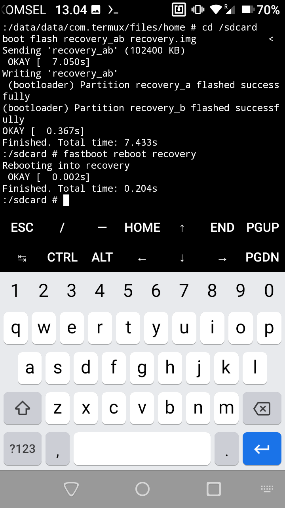
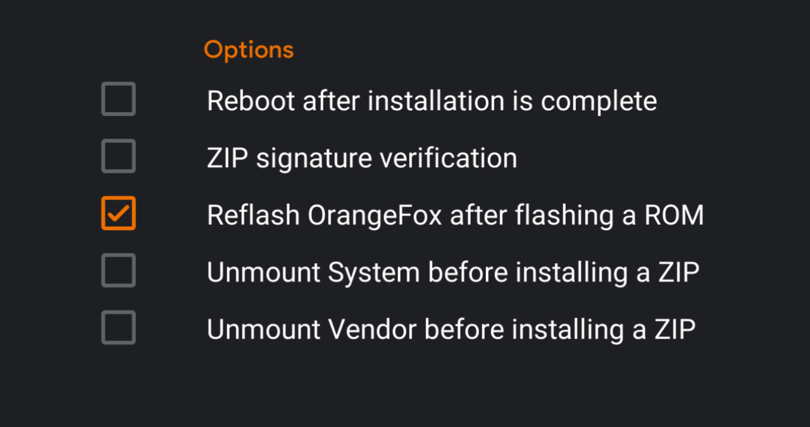

# Flash Recovery - Termux

Flash Recovery menggunakan Termux adalah alternatif selain PC / Bugjager. Namun ini khusus untuk hp yang sudah root. Karena harus Flash Module agar bisa menjalan fitur Adb & Fastboot di Android. Bebas mau Root Magisk / KSU sama aja ..

Disini saya akan menggunakan device POCO F5 (marble) yang akan saya pasang Recovery, dan Rakuten Mini sebagai media instalasi nya. Sama seperti Bugjaeger, Intinya menggunakan device yang support otg, gunakan otg+kabel usb atau c to c jika ada.

## Unduh Aplikasi:
[Termux F-Droid](https://f-droid.org/en/packages/com.termux/){.btn}

## Unduh Module:
[Adb&Fastboot for Android SDK](https://t.me/768/29672){.btn}

## Unduh Recovery:
[Download Recovery](/marble/recovery/download){.btn}

## Step Flash:
1️⃣ Flash Module [Adb&Fastboot](#unduh-module) di Magisk / KSU, kemudian reboot.


2️⃣ Install Aplikasi [Termux](#unduh-aplikasi), ketik
```
su
```
lalu enter



3️⃣ Ketik lagi
```
fastboot devices
```
lalu enter, untuk melihat device sudah terdetek apa belum.


4️⃣ Sekarang pergi ke folder tempat memyimpan recovery.img , misal saya letakan di /sdcard .. maka
```
cd /sdcard
```



5️⃣ Ketikan 
      ```
      fastboot flash recovery_ab(spasi)
      ```
lalu enter. Nanti akan muncul log seperti ini yg berarti sukses.


6️⃣ Pada hp Poco F5, tekan dan tahan tombol Power + Volume atas .. 
  
Atau jika mau pake command bisa ketik
```
fastboot reboot recovery
```
Hp akan masuk ke recovery.  


Catatan, pada bagian saat flash pastikan Reflash after Installing ROM tercentang, agar recovery tidak hilang ketika flash custom rom baru.



Selesai.  
Good Luck
